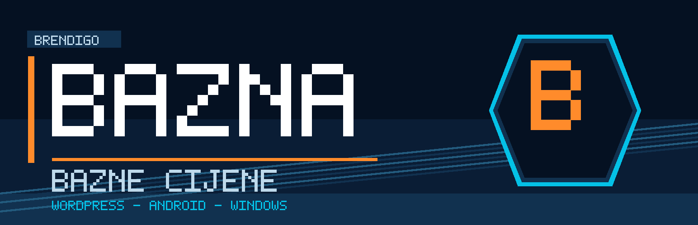
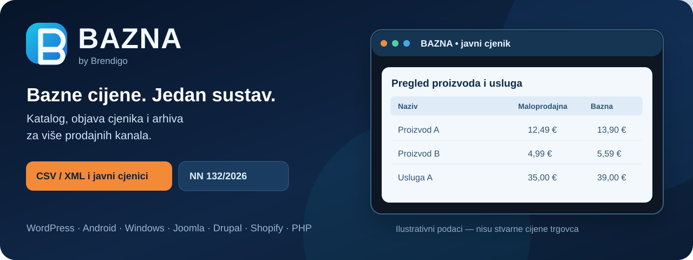

# BAZNA

### Bazne cijene · Javni cjenici · Arhiva

**Jasne cijene. Jednostavna objava. Pouzdana evidencija.**

Upravljajte proizvodima i uslugama, dokumentirajte povijesne bazne cijene i objavite pregledne cjenike u svojem digitalnom poslovanju — bez dodatnog korisničkog računa za BAZNA sustav.

[**Preuzmite BAZNA**](https://github.com/bren-wp/BAZNA/releases) · [**WordPress dodatak**](wordpress/brendigo-sidrena-cijena) · [**Vodič za instalaciju**](#instalacija-po-platformama) · [**Javni cjenici**](#javni-cjenici-i-arhiva-na-vlastitoj-stranici)

---

## Jedan standard cjenika, za više platformi

|  **BAZNA za vaš katalog** | **Što dobivate** |
| :--- | :--- |
| **Proizvodi i usluge** | Aktualna cijena, bazna cijena, povijesni izvor i podaci o poslovnici na preglednome mjestu |
| **Javna objava** | Ljudima čitljiv HTML cjenik i službene CSV/XML datoteke za automatizirani dohvat |
| **Arhiva objava** | Kronološki dostupne verzije objavljenih cjenika, uz evidenciju zamjene |
| **Ugradnja na stranicu** | WordPress kratki kodovi, tamni ili svijetli izgled te prilagodljiva boja i gustoća |
| **Rad na više uređaja** | WordPress/WooCommerce, Windows, Android i prilagodnici za PHP, Joomlu, Drupal i Shopify |

  

**Važno za povezivanje:** BAZNA koristi kompatibilne javne formate. Android čita već objavljene podatke putem HTTPS-a, a Windows ima lokalnu evidenciju. Automatska dvosmjerna sinkronizacija uređivanja između svih platformi nije uključena; službena objava provodi se u izvornom sustavu.

**Izdanje 1.5.25** osvježava javne WordPress podatke u Android aplikaciji nakon povratka u prvi plan, bez pozadinskog praćenja, zadržava siguran privatni Windows/WordPress nacrt te pojačava kontrole za WordPress.org i Google Play. Izdanja uključuju Android probni APK i nepotpisani AAB, Windows Portable/Setup te ZIP pakete platformi, ovisno o uspješnom CI-ju.

### Pravni temelj — 17. studenoga 2026.

- **NN 132/2026, br. 1583** — referentni datumi baznih cijena, posebno postupanje s popustima na referentni dan, iznimke i prikaz na prodajnim mjestima.
- **NN 132/2026, br. 1584** — objava cijena do **11:00 na dan izmjene**, javna arhiva najmanje **15 dana od zamjene**, obvezna strojna čitljivost **CSV/XML** i pristup automatiziranim alatima.
- **Odvojene evidencije:** aktualna cijena, bazna cijena i najniža cijena 30 dana prije sniženja nisu isto; bazna cijena se ne generira iz trenutačne cijene.

[Pravilnik o baznoj cijeni](https://narodne-novine.nn.hr/clanci/sluzbeni/2026_11_132_1583.html) · [Pravilnik o cjenicima](https://narodne-novine.nn.hr/clanci/sluzbeni/2026_11_132_1584.html) · [Revizija i otvorene stavke](docs/BAZNA-NN-132-2026-AUDIT.md)

**Važno:** izdanje sadrži tehničku implementaciju dijela zahtjeva, ali ne potvrđuje točnost cijena trgovca ni potpunu pravnu usklađenost bez provjerenih dokaza i integracijskih testova na stvarnim platformama.

## Sve funkcije bez aktivacijskog ključa

**BAZNA 1.5.25** ne provjerava aktivaciju, pretplatu, probni rok ili licencni poslužitelj. WordPress, Web, Joomla, Shopify adapter, Android i Windows rade bez BAZNA ključa. Sigurnosne kontrole za administratore i Shopify HMAC ostaju. GPL i obveze drugih licenci izvornog koda nisu uklonjene.

## Sve cijene na jednom mjestu

**BAZNA** pomaže poslovanju javno prikazivati cijene i jednostavno upravljati njihovim promjenama: od jedne poslovnice do kataloga s tisućama proizvoda i usluga. Cjenik nastaje iz provjerene evidencije, a objavljuje se ručno ili kroz nadziranu automatizaciju (PHP/Joomla/Drupal); svaka izmjena mora očuvati prethodnu javnu verziju.

- **Proizvodi i usluge** — aktualne cijene, jedinice mjere, SKU, barkod i dostupnost.
- **Bazne cijene** — povijesni iznos i datum povezani s izvornom evidencijom.
- **Poslovnice** — zasebni katalozi, javne objave i povijesni cjenici po lokaciji.
- **Javni cjenici** — pregledne HTML stranice te strojno čitljivi CSV/XML.
- **Arhiva** — dostupne nepromjenjive verzije već objavljenih cjenika.
- **Bez licenciranja** — sve funkcije dostupne bez aktivacije ili ključa.

## Usluge s cijenom na upit — sve javne platforme

Usluge kojima se iznos određuje prema opsegu, materijalu ili drugim
objavljenim kriterijima sada imaju zaseban, konzistentan prikaz.
Korisnik vidi **naziv, kriterije i poslovnicu**, bez izmišljene cijene.
WordPress, Web PHP, Joomla, Drupal i Shopify objavljuju ih tek nakon potvrde
kataloga; Android ih prikazuje iz sigurnog javnog REST API-ja.
Ti zapisi ne ulaze u numeričke CSV/XML cjenike.

Zadržani su postojeći WooCommerce podaci, cjenici, arhive, računi i
kompatibilni REST v1 URL-ovi. Android ne traži administratorsku lozinku
i služi za pregled, a ne upravljanje WordPressom.

[Usporedba s referentnim dodatkom 1.26.0](docs/BAZNA-FEATURE-PARITY-MJDD-1.26.0.md)
 · [Android upute](android/README.md)

## Jedna javna logika cjenika, uz punu kontrolu objave

**Funkcionalnosti uvedene od 1.5.23:** WordPress, samostalni Web PHP, Joomla i Shopify
prikazuju objavljene proizvode, usluge i usluge s cijenom na upit
uz jedinstvene nazive, iznose, povijesne datume i poslovnice.
Web omogućuje pretraživanje i odabir poslovnice, Joomla i Shopify
prikazuju prave objavljene stavke umjesto samo CSV poveznica,
a Androidova globalna pretraga obuhvaća i kriterije usluga na upit.

Objavljuju se samo potvrđeni podaci. Nacrt ostaje privatan,
povijesne vrijednosti ne generiraju se iz današnjih cijena,
a administratorske ovlasti ostaju odvojene između sustava.
Shopify adapter koristi potpisane zahtjeve, Android javni HTTPS API
i ne pristupa korisničkim računima u WordPressu.

[Detaljna matrica platformi](docs/BAZNA-FEATURE-PARITY-MJDD-1.26.0.md)

## Javni cjenici i arhiva na vlastitoj stranici

Postavite u WordPress blok **Kratki kod**: `[bazna_objava]` za pregledan cjenik s arhivom i poveznicama na stvarno objavljene službene CSV/XML datoteke. Odvojeni prikazi: `[bazna_cjenik]`, `[bazna_arhiva]` i `[bazna_datoteke]`. Za pojedinu poslovnicu koristite atribut `oznaka`; za robu/usluge `vrsta`.

**BAZNA → Postavke** nudi tamnu/svijetlu temu, četiri naglasne boje i razmake. Obvezni strojno čitljivi CSV/XML ostaje neovisan o izgledu HTML stranice. Ugrađivanje ne zamjenjuje poslužiteljski cron, obvezu objave do 11:00, javnu 15-dnevnu arhivu ni provjeru izvora bazne cijene.

[Upute za ugradnju, boje, CSV/XML i arhivu](docs/BAZNA-PUBLIC-EMBEDS.md)

## Jedan BAZNA ekosustav

| Platforma | Namjena | Verzija | Status |
|---|---|---|---|
| **WordPress + WooCommerce** | Upravljanje cjenicima, postojećim WordPress podacima, javnim objavama i arhivom | **1.5.25** | CI provjeren; kandidat WordPress.org paketa |
| **Web PHP** | Samostalni sustav bez WordPressa, grafički editor, lokalni JSON katalog, objava i arhiva | **1.1.6** | Funkcionalni paket; potreban test na stvarnom hostingu |
| **Joomla** | System plugin sa zajedničkim editorom, ACL/CSRF kontrolama, cjenicima i sigurnom administracijom | **1.1.6** | Kandidat; potreban instalacijski test u Joomli |
| **Drupal** | Nativni Drupal 10/11 modul na zajedničkoj PHP jezgri, javni REST i službeni CSV/XML | **1.1.6** | Razvojni kandidat; stvarni Drupal integracijski test potreban |
| **Shopify** | Zaseban PHP adapter s potpisanim app-proxyjem, uvozom EUR varijanti, theme blokom i privacy webhookovima | **1.1.6** | Custom-store kandidat; javni OAuth/App Store postupak nije dovršen |
| **Android** | Nativni javni pregled cijena, poslovnica i arhive s podržanih BAZNA stranica | **1.5.25** | Novi Play identifikator `com.brendigo.bazna`; debug APK i nepotpisani AAB |
| **Windows** | Lokalna obrada kataloga, povijesti cijena i izvoz s Portable/Setup paketima | **0.10.11** | Windows CI i stvarne provjere sučelja |

## Automatizirana objava i praćenje rokova

Web PHP, Joomla i Drupal koriste zajednički PHP Core za objavljivanje samo provjerenih cjenika. Postavite `BAZNA_AUTO_PUBLISH_VERIFIED=1` za automatsku objavu nakon spremanja u administraciji. Na shared hostingu postavite **poslužiteljski cron svake minute** koji pokreće `web/bin/publish.php` s konfiguriranim `BAZNA_PRIVATE_DIR`, `BAZNA_PUBLIC_URL` i OIB-om odnosno matičnim brojem. Zadaci su idempotentni: bez promjene podataka nema ponovnog izdavanja niti nove arhive. Neprovjerena bazna cijena ili nepotpuni podaci poslovnice blokiraju automatsku objavu. Bez pouzdanog schedulera nije moguće zajamčiti pravodobnu objavu.

WordPress koristi vlastiti mehanizam objave i mora imati provjeren raspored na hostingu. **Android ostaje samo čitač**, a Windows je lokalni alat; oba prikazuju upozorenje o zastarjelom pravnom profilu povezanog izvora.

## Jedinstveni podaci na svim platformama

Android koristi **javni BAZNA API v1** i ne traži administratorsku lozinku ni licencni ključ. Proizvodi, usluge i poslovnice prikazuju se iz *posljednje objavljenog* cjenika — ne iz neprovjerenog nacrta.

~~~text
WordPress / WooCommerce ─┐
BAZNA Web PHP ────────────┤
Joomla ───────────────────┼──> BAZNA javni API v1 ──> Android (samo čitanje)
Shopify app-proxy ────────┘             │
                                       ├──> HTML / CSV / XML
                                       └──> javna arhiva po poslovnici

~~~

| Platforma | Otkriće objavljenih cijena |
|---|---|
| Web PHP, Joomla i Drupal | `https://primjer.hr/bazna/v1/cjenici` |
| Shopify | `https://trgovina.myshopify.com/apps/bazna/v1/cjenici` |
| WordPress | Postojeća BAZNA REST v1 putanja, podržana i u pretty i u plain-permalink načinu |

**Važno:** zajednički javni format ne znače da svaki CMS ima identične administracijske mogućnosti. Shopify trenutačno treba zaseban server i autoriziranu instalaciju, a Android je namjerno **samo za čitanje**. Svaki kanal objavljuje vlastiti katalog; automatska dvosmjerna sinkronizacija svih trgovina nije implementirana bez dodatne autentificirane integracije.

## Instalacija po platformama

### WordPress / WooCommerce

**Postojeća WordPress.org instalacija:** koristite službeni [BAZNA/SIDRENA dodatak](https://wordpress.org/plugins/brendigo-sidrena-cijena/) s trajnim slugom `brendigo-sidrena-cijena`. Nakon izdavanja nove verificirane verzije u službenom WordPress.org SVN-u, ažurirajte ga kroz **Dodaci → Instalirani dodaci → Ažuriraj odmah** (ili omogućite WordPress automatska ažuriranja). Nije potrebna ponovna instalacija niti promjena direktorija.

1. Za ručnu ZIP instalaciju preuzmite `BAZNA-WordPress-<verzija>.zip` s [GitHub izdanja](https://github.com/bren-wp/BAZNA/releases); on koristi isti `brendigo-sidrena-cijena/` direktorij i glavni PHP fajl.
2. Instalirajte i aktivirajte dodatak, otvorite **BAZNA** te konfigurirajte proizvode, usluge i poslovnice.
3. Provjerite cijene, referentne datume i objavite javne CSV/XML cjenike.
4. Android povežite HTTPS adresom svoje stranice.

**Objava WordPress.org nadogradnji:** [GitHub Actions / SVN upute](docs/WORDPRESS-ORG-AZURIRANJE.md). Zaseban razvojni kandidat `bazna-cjenici` **nije** nadogradnja postojećeg službenog dodatka. GitHub izdanje samo po sebi ne objavljuje nadogradnju na WordPress.org.

### Samostalni PHP web — `/web`

1. Preuzmite **BAZNA-Web-1.1.6.zip**. Ne treba WordPress.
2. Potrebni su PHP 8.1+, HTTPS, pravila preusmjeravanja na `public/index.php` i **privatna mapa izvan webroota**.
3. Na serveru konfigurirajte `BAZNA_PUBLIC_URL`, `BAZNA_PRIVATE_DIR`, `BAZNA_ADMIN_PASSWORD_HASH`. Ključeve nemojte unositi u JavaScript ni u Git.
4. Otvorite `/bazna/admin` i preko kartica **Proizvodi**, **Usluge** i **Poslovnice** unesite podatke. Objavite ih kroz **Javni cjenici**.

[**Potpune PHP upute**](web/README.md)

### Joomla — `/joomla`

1. Preuzmite **BAZNA-Joomla-Plugin-1.1.6.zip** i instalirajte ga kroz **System → Install → Extensions**.
2. Omogućite *System – BAZNA*, konfigurirajte privatnu pohranu.
3. Otvorite BAZNA administratorski prikaz i koristite iste osnovne forme kao u samostalnom PHP sustavu.
4. Objavite katalog i povežite Android javnom HTTPS domenom.

[**Potpune Joomla upute**](joomla/README.md)

### Drupal — `/drupal/bazna`

Modul za Drupal 10.3/11 uključuje izričito objavljivanje provjerenog nacrta, administratorske ovlasti, javni v1 API, HTML i službene CSV/XML izvore. Potrebno je postaviti privatnu pohranu i identifikator trgovca. Drupal još nema provjerenu vizualnu 1:1 podudarnost s WordPressom ni Drupal Commerce integraciju.

[**Upute za Drupal**](drupal/bazna/README.md)

### Shopify — `/shopify`

Shopify **ne izvršava PHP u temi**. BAZNA koristi zaseban PHP backend povezan s autoriziranom trgovinom preko **potpisanog app-proxyja**. Dostupan je Shopify theme app extension za javni cjenik te serverski uvoz varijanti preko Shopify Admin API-ja.

Za objavu su potrebni registrirana trgovina, Shopify vjerodajnice, privatna pohrana bez BAZNA licenciranja. Shopify usporedna cijena nije dokaz povijesne bazne cijene. **Javna Shopify App Store distribucija još nije spremna:** potreban je potpuni OAuth postupak, trgovinski UI i preostale provjere aplikacije.

[**Potpune Shopify upute**](shopify/README.md)

### Android i Windows

Android se povezuje sa stvarnim javnim katalogom preko HTTPS-a. APK služi za instalaciju i testiranje; **nepotpisani AAB nije spreman za Google Play** bez odgovarajućeg produkcijskog potpisa. Windows izdanje sadrži Portable.exe i Setup.exe iz stvarnog Windows builda.

[Android upute](android/README.md) · [Google Play i migracija](docs/BAZNA-ANDROID-PACKAGE-MIGRATION.md) · [Windows upute](desktop/README.md)

## Vizualni identitet i slike za Google Play

BAZNA Play Store paket proizvodi se isključivo iz uspješno provjerenih **stvarnih Android emulator snimki**: ikona 512 × 512, feature graphic 1024 × 500, osam telefonskih slika 1080 × 1920, svih 12 zaslona i dvije kolekcije tablet prikaza. Korišten je postojeći narančasti znak B i tamnoplava paleta; aplikacijski zasloni nisu izmišljene makete.

[Upute za Play brending](docs/BAZNA-GOOGLE-PLAY-BRANDING.md) · [Tekst za Play Console](docs/BAZNA-GOOGLE-PLAY-STORE-LISTING-HR.txt) · [Workflow za artefakte](.github/workflows/play-store-assets.yml)

## Stvarni ekrani i provjere sučelja

Ne koristimo izmišljene „screenshotove aplikacije”. Sljedeći GitHub Actions postupci spremaju **stvarne slike provedenih testova**, dostupne u dijelu *Artifacts* dok traje GitHubovo razdoblje zadržavanja:

| Platforma | Stvarni dokaz |
|---|---|
| [Android — 12 ekrana × 9 konfiguracija](https://github.com/bren-wp/BAZNA/actions/workflows/android-ci.yml) | Compose emulator prikazi i provjere različitosti zaslona |
| [WordPress — responzivnost](https://github.com/bren-wp/BAZNA/actions/workflows/official-plugin-ci.yml) | Javni cjenik i administratorske kartice na 13 širina |
| [Web i Joomla — 195 prikaza](https://github.com/bren-wp/BAZNA/actions/workflows/multiplatform-ci.yml) | 15 prikaza × 13 širina; stvarni predlošci i zajednički editor |
| [Windows — 10 prikaza](https://github.com/bren-wp/BAZNA/actions/workflows/desktop-ci.yml) | Stvarno WPF sučelje i provjere navigacije |

Prolazak responzivnih i funkcionalnih testova **nije dokaz 0 % vizualnog odstupanja** od referenci. Za pixel-perfect potvrdu trebaju odgovarajući izvorni PNG-ovi, ista razlučivost i automatizirana usporedba.

## Hrvatski propisi, povijesne cijene i sigurnost

BAZNA čuva razliku između **aktualne cijene**, **povijesne bazne cijene** i **najniže cijene u 30 dana prije sniženja**. Ne izvodi baznu cijenu iz današnjeg iznosa ni Shopifyjeve usporedne cijene. Povijesni iznos zahtijeva stvarni datum i potvrdu dokaza.

Od **17. studenoga 2026.** važe pravilnici NN 132/2026 br. 1583 i 1584. Pravni profil bilježi objavljene propise; pojedini trgovac mora dodatno dokazati povijesne iznose, ispravno primijeniti iznimke i testirati točnost svojih javnih cjenika. Softver nije pravni certifikat.

Zaštite uključuju HTTPS javno čitanje, administratorske CSRF/ACL kontrole, atomsku pohranu, zaštitu od zastarjelih izmjena i provjeru Shopify potpisanih zahtjeva. Sigurnosni audit u CI-ju nije zamjena za produkcijski penetracijski test.

## Dokumentacija

[Arhitektura i kompatibilnost](docs/BAZNA-MULTIPLATFORM-ARCHITECTURE.md) · [Pravni okvir](docs/LEGAL-2026-INTEROPERABILITY.md) · [Android i WordPress](docs/ANDROID-WORDPRESS-INTEGRATION-AUDIT-159.md) · [Vizualni standard](docs/PIXEL-PERFECT-QA.md) · [Sigurnosna i dead-code revizija 1.5.24](docs/BAZNA-SECURITY-DEADCODE-1.5.24.md)

---

**BAZNA by Brendigo**  
*Cijene pod kontrolom. Poslovanje s povjerenjem.*

[brendigo.com](https://brendigo.com/) · [GitHub izdanja](https://github.com/bren-wp/BAZNA/releases)

